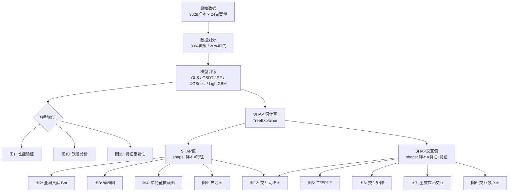

# GBDT-SHAP 图例解读指南

> 本文档基于 `plot_shap.py` 的代码逻辑，系统解释 12 张图的**绘制原理**、**阅读方法**和**理论发现**。
> 因变量示例为"步行比例"（SHAP 分析模型为 LightGBM）。

---

## 目录

1. [图1：模型性能验证图](#图1模型性能验证图)
2. [图2：SHAP 全局特征贡献图](#图2shap-全局特征贡献图)
3. [图3：SHAP 蜂群图](#图3shap-蜂群图)
4. [图4：SHAP 单特征依赖图](#图4shap-单特征依赖图)
5. [图5：二维 PDP 部分依赖图](#图5二维-pdp-部分依赖图)
6. [图6：特征交互效应复合矩阵图](#图6特征交互效应复合矩阵图)
7. [图7：主效应与交互效应对比图](#图7主效应与交互效应对比图)
8. [图8：SHAP 成对交互散点图](#图8shap-成对交互散点图)
9. [图9：SHAP 热力图](#图9shap-热力图)
10. [图10：各模型残差图](#图10各模型残差图)
11. [图11：最佳树模型特征重要性图](#图11最佳树模型特征重要性图)
12. [图12：SHAP 特征交互网络图](#图12shap-特征交互网络图)

---

## 整体分析框架



### 核心数据结构

| 数据 | 维度 | 含义 |
|------|------|------|
| **SHAP 值** | `(n_samples, n_features)` | 每个样本中每个特征对预测值的边际贡献 |
| **SHAP 交互值** | `(n_samples, n_features, n_features)` | 对角线 = 主效应，非对角线 = 两两交互效应 |

---

## 图1：模型性能验证图

### 📐 绘图逻辑

图1 被拆分为 **3 张独立子图**，保存在 `图1_模型性能验证/` 子目录中：

| 子图 | 文件名 | 内容 |
|------|--------|------|
| **(a)** | `01_R2对比.png` | 5 个模型（OLS、GBDT、RF、XGBoost、LightGBM）的测试集 R² 柱状图 |
| **(b)** | `02_JointPlot_LightGBM.png` | 最优模型的预测值 vs 实际值散点图 + 边际分布 + 底部残差 |
| **(c)** | `03_残差分布_LightGBM.png` | 最优模型的残差直方图 + 正态拟合曲线 |

**代码关键步骤：**
- 使用 `experiment.py` 保存的最优超参数重新训练所有模型
- 数据经过 `StandardScaler` 标准化（基于训练集 fit，测试集 transform）
- 图(b) 同时展示训练集（蓝色）和测试集（红色）的散点，叠加 45° 参考线和拟合线
- 图(b) 底部嵌入残差散点图，展示残差随预测值的分布
- 图(c) 使用 `scipy.stats.norm.fit` 拟合正态分布

### 🔍 如何看图

**图(a) R² 对比柱状图：**
- 柱子越高 → R² 越大 → 模型拟合越好
- SHAP 分析所用的模型会用**加粗边框**高亮
- 关注 OLS 与树模型之间的 R² 差距——差距越大，说明数据中的**非线性关系**越强

**图(b) Joint Plot：**
- 散点越贴近 45° 虚线 → 预测越准确
- 左上角标注了训练集和测试集的 R² 和 RMSE
- 顶部和右侧的边际分布展示了实际值和预测值的分布形态
- 底部残差图：残差应随机分布在 0 线两侧，若呈现系统性模式则说明模型存在偏差

**图(c) 残差直方图：**
- 残差应近似正态分布，以 0 为中心
- 正态拟合曲线的 μ 应接近 0，σ 越小越好
- 若分布明显偏斜或有厚尾，说明模型对某些区间的预测存在系统性偏差

### 💡 理论发现

1. **非线性存在性验证**：若 LightGBM/XGBoost 的 R² 显著高于 OLS，说明因变量与自变量之间存在大量**非线性关系和变量交互效应**，传统线性回归无法充分捕捉
2. **模型可信度**：R² 足够高（如 > 0.7）是后续所有 SHAP 解释的**合法性前提**——如果模型本身不准确，基于它的解释就没有意义
3. **过拟合检测**：训练集与测试集 R² 差距过大（如 > 0.1）提示过拟合风险

---

## 图2：SHAP 全局特征贡献图

### 📐 绘图逻辑

- 使用 `shap.plots.bar()` 绘制水平条形图
- 横轴为 **平均 |SHAP 值|**（mean absolute SHAP value），纵轴为特征名称
- 特征按平均 |SHAP 值| 从高到低排列
- 条形颜色统一为主题色（步行比例为蓝色系）
- 移除了条形图上的数字标注，保持图面简洁

### 🔍 如何看图

- **条形越长** → 该特征对预测结果的平均影响越大
- 排名靠前的特征是模型认为最重要的因素
- 注意：这里只反映**影响大小**，不反映影响方向（正/负）

### 💡 理论发现

- **关键因素识别**：排名前 5 的特征揭示了影响因变量的核心驱动因素
- **维度归纳**：观察排名靠前的变量属于哪些维度（交通可达性？路网形态？土地利用？空间品质？），可以归纳出问题的本质——例如"步行孤岛本质上是空间连通性问题"还是"功能缺失问题"
- **创新变量验证**：如果大模型感知评分类变量排名较高，说明主观感知层面的因素被传统分析低估

---

## 图3：SHAP 蜂群图

### 📐 绘图逻辑

- 使用 `shap.plots.beeswarm()` 绘制
- 纵轴为特征（按重要性排序），横轴为 SHAP 值
- 每个**点**代表一个样本（街区）
- 点的**颜色**表示该特征的原始值高低（使用发散型色带：蓝色 = 低值，红色 = 高值）
- 点在纵向上做蜂群式抖动，避免重叠

### 🔍 如何看图

- **SHAP 值 > 0**（右侧）：该特征在该样本中**推高**了预测值
- **SHAP 值 < 0**（左侧）：该特征在该样本中**拉低**了预测值
- **颜色与位置的对应关系**是关键：
  - 红色点（高值）集中在右侧 → **正向单调关系**（特征值越高，预测值越高）
  - 红色点集中在左侧 → **负向单调关系**（特征值越高，预测值越低）
  - 红色和蓝色点在左右两侧**混杂** → **非线性关系**或存在交互效应
- **点的分散程度**反映该特征影响的**异质性**——越分散，说明该特征对不同样本的影响差异越大

### 💡 理论发现

1. **影响方向判断**：快速识别每个因素是"保护因素"（降低孤岛指数）还是"风险因素"（推高孤岛指数）
2. **非线性线索发现**：当某个变量的点分布出现"撕裂"（高值样本的 SHAP 值既正又负），提示该变量存在非线性关系或与其他变量的交互效应，需要在图4中深入分析
3. **异质性揭示**：同一特征值水平下 SHAP 值的分散程度，反映了其他变量的调节作用

---

## 图4：SHAP 单特征依赖图

### 📐 绘图逻辑

为**所有 24 个自变量**各绘制一张图，保存在 `图4_SHAP依赖图/` 子目录中，按平均 |SHAP 值| 排名编号。

每张图包含以下元素：

| 元素 | 说明 |
|------|------|
| **散点** | 横轴 = 特征原始值（经 `scaler.inverse_transform` 还原），纵轴 = 该特征的 SHAP 值 |
| **LOWESS 曲线** | 局部加权散点图平滑（`frac=0.3`），揭示非线性趋势 |
| **95% 置信区间** | 通过 200 次 Bootstrap 重采样计算，反映趋势的不确定性 |
| **内嵌柱状分布** | 灰色直方图嵌入散点图底部（约占 25% 高度），展示特征值的分布密度 |
| **y=0 水平虚线** | SHAP = 0 的参考线，区分正向/负向影响 |

**关键技术细节：**
- 去除了原始 SHAP 依赖图中的交互着色（不用颜色编码第二个变量），只展示**纯粹的单变量效应**
- LOWESS 拟合使用 `statsmodels.nonparametric.lowess`
- Bootstrap 置信区间通过 `scipy.interpolate.interp1d` 插值对齐

### 🔍 如何看图

1. **趋势方向**：LOWESS 曲线的走向
   - 上升趋势 → 特征值增大时推高预测值
   - 下降趋势 → 特征值增大时拉低预测值
2. **非线性形态**：
   - **单调递增/递减** → 线性或近似线性关系
   - **倒 U 型 / U 型** → 存在最优值或最差值
   - **分段线性（拐点）** → 存在阈值效应
   - **S 型** → 存在饱和效应
3. **阈值识别**：LOWESS 曲线与 y=0 线的交叉点是关键阈值——在此值两侧，特征的影响从正变负（或反之）
4. **置信区间宽度**：
   - 窄 → 趋势可靠
   - 宽 → 样本稀疏或关系不稳定（通常出现在特征值的极端区域）
5. **底部柱状分布**：帮助判断哪些区间的样本量充足（结论可靠），哪些区间样本稀疏（结论需谨慎）

### 💡 理论发现

- **阈值效应**：例如"距地铁站 800m 是步行孤岛风险的关键阈值"——超过此距离后 SHAP 值从负转正
- **非线性关系量化**：例如"交叉口密度与步行比例呈倒 L 型关系——密度从低值增加时效果显著，超过某值后边际效应趋于平缓"
- **U 型关系发现**：例如"主干道密度呈 U 型——适中密度最有利，过高（切割效应）或过低（可达性差）均不利"
- **规划标准制定**：阈值点直接对应规划导则中的数值标准

---

## 图5：二维 PDP 部分依赖图

### 📐 绘图逻辑

为**所有 24 个自变量**各绘制一张图，保存在 `图5_二维PDP/` 子目录中。

**配对逻辑（核心）：**
1. 利用 SHAP 交互值矩阵 `(n_samples, n_features, n_features)`
2. 对每个变量 A，计算它与所有其他变量的平均 |SHAP 交互值|
3. 选择交互值最大的变量 B 作为 A 的"最强交互搭档"
4. 绘制 A × B 的二维偏依赖图

**绘图细节：**
- 使用 `sklearn.inspection.partial_dependence` 计算二维偏依赖值（`grid_resolution=30`）
- 绘制等高线填充图（`contourf`）+ 白色等高线（`contour`）
- 等高线上标注数值（加粗，字号 13）
- 坐标轴经 `scaler.inverse_transform` 还原为原始值
- 右侧 colorbar 标注"部分依赖值"

### 🔍 如何看图

1. **颜色深浅**：代表两个变量同时取某值时，模型预测值的变化
   - 暖色（高值）→ 预测值高
   - 冷色（低值）→ 预测值低
2. **等高线密集程度**：等高线越密集的区域，预测值变化越剧烈（梯度大）
3. **等高线方向**：
   - 等高线平行于某轴 → 预测值主要受另一个轴的变量控制
   - 等高线呈对角线方向 → 两个变量存在**交互效应**
   - 等高线弯曲 → 非线性交互
4. **标题中的交互强度值**：数值越大，说明这对变量的交互越显著

### 💡 理论发现

- **协同效应**：当两个变量同时处于有利区间时，效果远超各自单独的效果之和（1+1 > 2）
- **补偿效应**：一个变量的不利条件可以被另一个变量的有利条件部分抵消
- **最优组合识别**：等高线图中预测值最低/最高的区域，对应最优/最差的变量组合
- **规划策略启示**：颜色梯度方向暗示了最有效的改善路径——沿梯度方向调整变量组合，可以最快地改善预测值

---

## 图6：特征交互效应复合矩阵图

### 📐 绘图逻辑

- 计算所有特征对 (i, j) 的 **平均 |SHAP 交互值|**：`np.abs(shap_interaction[:, i, j]).mean()`
- 将对角线（主效应）置零，只展示纯交互效应
- 使用 `seaborn.heatmap` 绘制对称矩阵热力图
- 颜色使用顺序型色带（步行比例为粉红渐变）
- 同时在日志中输出 **Top 10 交互对**的排名

### 🔍 如何看图

- **颜色越深** → 该变量对之间的交互效应越强
- **行/列扫描**：某一行（或列）整体颜色较深 → 该变量是"枢纽型变量"，与多个其他变量都有显著交互
- **对称性**：矩阵关于对角线对称（交互效应 A→B = B→A）
- **对角线为零**：对角线被置零，因为对角线代表主效应而非交互效应

### 💡 理论发现

- **交互全景扫描**：快速识别哪些变量对之间存在显著的耦合关系
- **枢纽变量发现**：如果某个变量与多个其他变量都有强交互，说明它是系统中的"关键节点"——改变它会产生连锁反应
- **为深入分析提供依据**：矩阵中最深色的单元格，就是后续图5（二维PDP）和图8（交互散点图）应重点分析的变量对
- **非独立性论证**：如果矩阵中存在大量深色单元格，说明各因素**不是独立作用的简单叠加**，而是存在显著的因素耦合效应

---

## 图7：主效应与交互效应对比图

### 📐 绘图逻辑

由**左右两个子图**组成：

**左图——堆叠条形图：**
- 每个变量拆分为两部分：
  - **主效应**（蓝色）：SHAP 交互矩阵对角线元素的平均绝对值 `|shap_interaction[:, i, i]|.mean()`
  - **交互效应**（粉红色）：非对角线元素的平均绝对值之和 `Σ_{j≠i} |shap_interaction[:, i, j]|.mean()`
- 按总效应（主效应 + 交互效应）从小到大排列

**右图——交互占比柱状图：**
- 每个变量的交互效应占总效应的百分比
- 颜色编码：
  - 红色：占比 > 30%（高交互）
  - 中等色：占比 15%~30%（中等交互）
  - 灰色：占比 < 15%（低交互）
- 标注 15% 和 30% 两条阈值虚线

### 🔍 如何看图

**左图：**
- 蓝色部分越长 → 该变量的独立影响越大
- 粉红色部分越长 → 该变量与其他变量的交互影响越大
- 两色的相对比例是关键信息

**右图：**
- 红色条 → 该变量的影响**高度依赖于其他变量的配合**，不能单独干预
- 灰色条 → 该变量可以**独立发挥作用**，单独干预即可见效

### 💡 理论发现

- **独立干预 vs 配套干预**：
  - 交互占比低的变量 → 可以制定**单项策略**（如"增加交叉口密度"）
  - 交互占比高的变量 → 必须制定**组合策略**（如"增加主干道密度的同时必须配套安全过街设施"）
- **线性可加假设检验**：如果大多数变量的交互占比都很低（< 15%），说明线性可加模型（如 OLS）的假设基本成立；反之则说明非线性交互不可忽视
- **政策优先级**：主效应大且交互占比低的变量是最"划算"的干预目标——投入产出比最高

---

## 图8：SHAP 成对交互散点图

### 📐 绘图逻辑

**选对逻辑：**
1. 计算所有 C(n,2) 个变量对的平均 |SHAP 交互值|
2. 按交互强度从高到低排序
3. 取 **Top 5** 交互对

**每张图的内容：**
- 横轴 = 变量 A 的原始值（经反标准化）
- 纵轴 = A 与 B 的 **SHAP 交互值**（`shap_interaction[:, i, j]`）——注意这是**纯交互效应**，已剥离主效应
- 颜色 = 变量 B 的原始值（使用发散型色带）
- y=0 水平参考线

所有图保存在 `图8_交互散点图/` 子目录中，按交互强度排名编号。

### 🔍 如何看图

1. **纵轴含义**：SHAP 交互值 ≠ 总 SHAP 值。它只反映"因为 B 的存在，A 的影响额外增加/减少了多少"
2. **颜色分层**：
   - 如果不同颜色的点在纵向上明显分层 → 变量 B 的值确实在调节变量 A 的影响
   - 如果颜色混杂无规律 → 交互效应可能是非线性的或局部的
3. **交互方向**：
   - B 高值（暖色）时交互值为正，B 低值（冷色）时为负 → **正向交互**（B 放大了 A 的正效应）
   - 反之 → **负向交互**（B 抑制了 A 的效应）
4. **与图4的区别**：图4展示的是变量 A 的**总 SHAP 值**（主效应 + 交互效应混合），而图8**只展示纯交互部分**

### 💡 理论发现

- **调节效应量化**：精确展示"在什么条件下，某个因素的影响会被放大或抑制"
- **条件性影响**：例如"当步行安全感较高时，主干道密度的增加几乎不增加孤岛风险；但当安全感较低时，主干道密度的增加会额外增加显著的孤岛风险"
- **干预条件识别**：帮助识别"在什么前提条件下，某项干预措施才有效"

---

## 图9：SHAP 热力图

### 📐 绘图逻辑

- 使用 `shap.plots.heatmap()` 绘制
- 横轴 = 所有特征
- 纵轴 = 所有样本（按模型预测值排序）
- 单元格颜色 = SHAP 值（红色 = 正贡献/推高预测值，蓝色 = 负贡献/拉低预测值）
- 图的尺寸为 14×10 英寸，展示全部特征

### 🔍 如何看图

1. **纵向扫描**（某一列）：观察某个特征在不同样本中的 SHAP 值分布
   - 整列偏红 → 该特征对大多数样本都有正向影响
   - 整列偏蓝 → 该特征对大多数样本都有负向影响
   - 红蓝交替 → 该特征的影响因样本而异（异质性强）
2. **横向扫描**（某一行）：观察某个样本受哪些特征影响
   - 某行红色集中在特定几列 → 该样本的高预测值主要由这几个特征驱动
3. **模式识别**：
   - 图的上半部分（高预测值样本）和下半部分（低预测值样本）的颜色模式差异，揭示了"高值样本和低值样本的成因是否相同"
   - 如果上半部分出现多种不同的"红色模式"，说明存在**多种不同的成因组合**

### 💡 理论发现

- **样本级全景分析**：从宏观视角观察所有样本的 SHAP 值分布模式
- **类型学验证**：如果热力图中出现明显的"条纹模式"（不同区域的红色集中在不同列），说明存在不同的成因类型
- **异常样本发现**：颜色模式与周围样本明显不同的行，可能是值得深入分析的异常案例

---

## 图10：各模型残差图

### 📐 绘图逻辑

为 5 个模型（OLS、GBDT、RF、XGBoost、LightGBM）各绘制一张残差图，保存在 `图10_残差图/` 子目录中。

每张图：
- 横轴 = 预测值
- 纵轴 = 残差（实际值 - 预测值）
- 散点颜色使用各模型的专属颜色（OLS 灰色、GBDT 蓝色、RF 绿色、XGBoost 红色、LightGBM 紫色）
- y=0 水平参考线

### 🔍 如何看图

1. **随机性**：理想情况下，残差应随机分布在 0 线两侧，无明显模式
2. **系统性偏差**：
   - 残差呈漏斗形（随预测值增大而发散）→ **异方差性**
   - 残差呈曲线形 → 模型存在**系统性偏差**，未捕捉到某种非线性关系
   - 残差在某个区间集中偏正/偏负 → 模型在该区间**系统性高估/低估**
3. **模型对比**：比较不同模型的残差图，残差分布越随机、越集中在 0 附近的模型越好

### 💡 理论发现

- **模型适用性评估**：OLS 的残差图若呈现明显的曲线模式，直接证明了线性假设不成立
- **预测盲区识别**：残差较大的区间是模型的"盲区"，可能需要额外的特征或更复杂的模型
- **异方差性检测**：若残差呈漏斗形，说明模型在不同预测值水平上的精度不一致

---

## 图11：最佳树模型特征重要性图

### 📐 绘图逻辑

- 自动选择测试集 R² 最高的树模型
- 使用模型内置的 `feature_importances_` 属性（基于分裂增益）
- 绘制水平条形图，特征按重要性从低到高排列（最重要的在最上方）

### 🔍 如何看图

- **条形越长** → 该特征在树模型的分裂决策中被使用得越频繁/贡献越大
- **与图2（SHAP Bar）的对比**是关键：
  - 两者排名一致 → 结论稳健
  - 两者排名不一致 → 需要分析原因（`feature_importances_` 基于分裂增益，可能受特征尺度和相关性影响；SHAP 值更准确）

### 💡 理论发现

- **交叉验证**：与 SHAP 重要性排名对比，验证结论的稳健性
- **模型内部机制**：了解树模型在构建过程中最依赖哪些特征进行分裂
- **注意局限性**：`feature_importances_` 可能高估高基数特征的重要性，SHAP 值更可靠

---

## 图12：SHAP 特征交互网络图

### 📐 绘图逻辑

使用 `networkx` 构建圆形布局的网络图：

**节点属性：**
- 位置：沿圆周均匀分布（`nx.circular_layout`）
- 大小：∝ 平均 |SHAP 值|（Vimp），映射到 [300, 2800]
- 颜色：绿色渐变，深浅 ∝ Vimp

**边属性（三级分类）：**

| 类别 | 条件 | 样式 |
|------|------|------|
| **强边** | 交互强度 ≥ 最大值 × 20% | 紫色渐变，线宽 1~10 |
| **弱边** | 交互强度在 5%~20% 之间 | 浅灰色细线（0.4 宽） |
| **过滤** | 交互强度 < 最大值 × 5% | 不绘制 |

**双 colorbar：**
- 右上：Vint（紫色渐变）— 边的交互强度
- 右下：Vimp（绿色渐变）— 节点的重要性

**标签：**
- 放在圆周外侧，沿径向偏移 0.18
- 字号 12，加粗

### 🔍 如何看图

1. **节点大小**：越大的节点 → 该特征的独立影响越大
2. **节点颜色**：越深绿 → 重要性越高
3. **紫色连线**：越粗越深 → 两个特征之间的交互越强
4. **灰色细线**：弱交互，仅作为背景参考
5. **网络结构**：
   - 某个节点连接了多条粗紫线 → 该特征是"枢纽"，与多个特征都有强交互
   - 两个大节点之间有粗紫线 → 两个重要特征之间还存在强交互，是最值得关注的变量对
   - 孤立节点（无粗紫线）→ 该特征主要独立发挥作用

### 💡 理论发现

- **系统结构可视化**：直观展示所有变量之间的影响力和交互关系的"全景图"
- **枢纽变量识别**：度中心性高的节点是系统中的关键杠杆点
- **子群发现**：如果网络中出现明显的"簇"（几个节点之间互相连接紧密），说明这些变量构成了一个功能子系统
- **传播路径推断**：沿着粗紫线的路径，可以推断变量之间的影响传播链

---

## 图例之间的逻辑关系

```mermaid
graph LR
    subgraph 第一层：模型验证
        P1[图1: 性能验证] --> P10[图10: 残差分析]
        P1 --> P11[图11: 特征重要性]
    end
    
    subgraph 第二层：全局概览
        P2[图2: 特征贡献排名] --> P3[图3: 蜂群图<br/>方向+异质性]
    end
    
    subgraph 第三层：单变量深入
        P3 --> P4[图4: 依赖图<br/>非线性+阈值]
    end
    
    subgraph 第四层：交互分析
        P6[图6: 交互矩阵<br/>全景扫描] --> P5[图5: 二维PDP<br/>联合效应面]
        P6 --> P7[图7: 主效应vs交互<br/>占比拆解]
        P6 --> P8[图8: 交互散点<br/>纯交互机制]
        P6 --> P12[图12: 交互网络<br/>结构可视化]
    end
    
    subgraph 第五层：样本级分析
        P9[图9: 热力图<br/>样本全景]
    end
    
    P1 -->|模型可信| P2
    P3 -->|非线性线索| P4
    P4 -->|交互需求| P6
    P7 -->|高交互变量| P8
```

### 推荐阅读顺序

| 步骤 | 图例 | 回答的问题 |
|------|------|-----------|
| 1 | 图1 + 图10 | 模型可信吗？非线性存在吗？ |
| 2 | 图2 + 图11 | 哪些因素最重要？ |
| 3 | 图3 | 每个因素的影响方向和异质性？ |
| 4 | 图4 | 每个因素的非线性形态和阈值？ |
| 5 | 图6 | 哪些变量对之间存在交互？ |
| 6 | 图7 | 每个变量的交互占比多大？能否独立干预？ |
| 7 | 图5 | 最强交互对的联合效应面是什么样的？ |
| 8 | 图8 | 交互的具体机制是什么？（纯交互效应） |
| 9 | 图9 | 样本层面是否存在不同的成因模式？ |
| 10 | 图12 | 变量间的整体交互结构是什么样的？ |

---

## 关键概念辨析

### SHAP 值 vs SHAP 交互值

| | SHAP 值 | SHAP 交互值 |
|---|---------|------------|
| **维度** | (样本, 特征) | (样本, 特征, 特征) |
| **含义** | 特征 i 对预测值的**总贡献** | 特征 i 和 j 之间的**交互贡献** |
| **分解关系** | SHAP_i = 主效应_i + Σ交互效应_{i,j} | 对角线 = 主效应，非对角线 = 交互效应 |
| **使用图例** | 图2, 图3, 图4, 图9 | 图5, 图6, 图7, 图8, 图12 |

### 特征重要性 vs SHAP 重要性

| | `feature_importances_`（图11） | 平均 \|SHAP 值\|（图2） |
|---|------|------|
| **计算方式** | 基于树分裂时的信息增益 | 基于博弈论的 Shapley 值 |
| **优点** | 计算快速 | 理论严谨，考虑特征间相关性 |
| **缺点** | 可能高估高基数特征 | 计算较慢 |
| **推荐** | 作为辅助参考 | 作为主要依据 |

### PDP vs SHAP 依赖图

| | 二维 PDP（图5） | SHAP 依赖图（图4） |
|---|------|------|
| **展示内容** | 两个变量联合变化时的**平均预测值** | 单个变量的 SHAP 值随其取值的变化 |
| **包含效应** | 主效应 + 交互效应（混合） | 主效应 + 交互效应（混合） |
| **优势** | 直观展示联合效应面 | 展示每个样本的具体贡献 |
| **局限** | 假设变量独立（可能失真） | 无法直接展示两变量的联合效应 |

### SHAP 交互散点图 vs SHAP 依赖图

| | 交互散点图（图8） | 依赖图（图4） |
|---|------|------|
| **纵轴** | **纯交互效应**（`shap_interaction[:, i, j]`） | **总 SHAP 值**（主效应 + 交互效应） |
| **用途** | 分析"B 如何调节 A 的影响" | 分析"A 的整体影响趋势" |
| **信息纯度** | 高（已剥离主效应） | 低（主效应和交互效应混合） |
